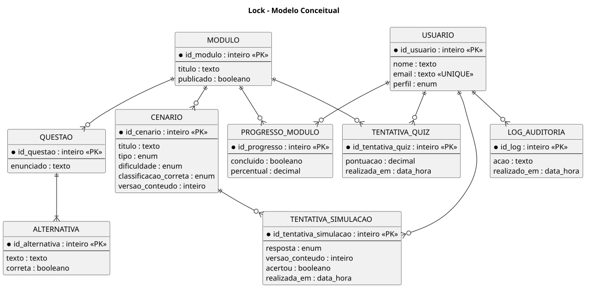
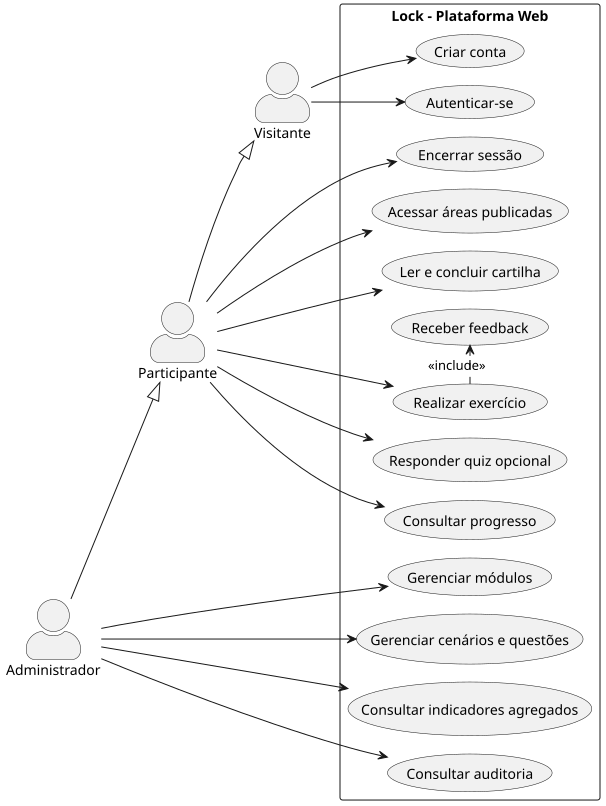
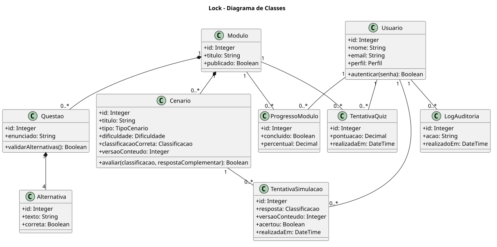
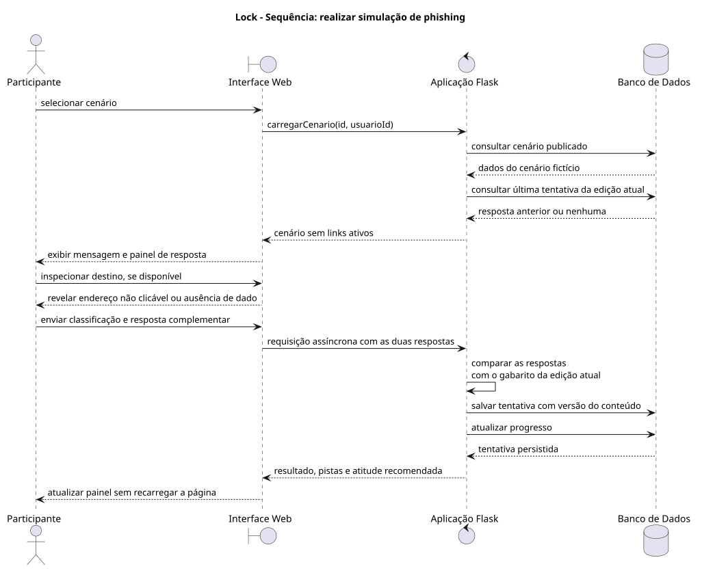

# Etapa 02 — Requisitos e modelagem

Especificação dos requisitos e modelos que orientam a implementação do Lock.

> [!NOTE]
> Os exercícios acontecem somente dentro da plataforma. O protótipo não se
> integra a sistemas corporativos nem envia mensagens a terceiros.

## Resumo da etapa

A modelagem descreve os atores, treze requisitos funcionais, nove requisitos não
funcionais, oito regras de negócio e cinco casos de uso textuais. Os diagramas
complementam a especificação: modelo conceitual, casos de uso, classes e
sequência. O percurso publicado para o participante contém uma cartilha e oito
exercícios; quizzes permanecem disponíveis para módulos adicionais.

## 1. Análise de requisitos

### 1.1 Visão geral

O Lock é uma plataforma web responsiva de conscientização contra phishing. A
solução possui dois perfis: **participante**, que lê a cartilha e realiza exercícios,
e **administrador**, que mantém os conteúdos e acompanha os resultados. As
simulações são cenários fictícios exibidos apenas dentro do sistema; a aplicação
não envia campanhas nem coleta credenciais de terceiros. Elementos visuais de
marcas aparecem somente como contexto didático, sem afiliação com as empresas.

Na especificação, **cenário** é a mensagem fictícia cadastrada; **exercício** é
essa mensagem apresentada ao participante; **tentativa** é a resposta salva.

### 1.2 Atores do sistema

| Ator | Descrição |
|---|---|
| Visitante | Pessoa ainda não autenticada, que pode criar uma conta ou entrar. |
| Participante | Usuário autenticado que acessa cartilha, exercícios, eventual quiz publicado e seu progresso. |
| Administrador | Usuário autorizado a administrar conteúdos e consultar indicadores agregados. |

### 1.3 Requisitos funcionais

| ID | Requisito |
|---|---|
| RF01 | O sistema deve permitir que um visitante crie uma conta com nome, e-mail e senha. |
| RF02 | O sistema deve autenticar o usuário e encerrar sua sessão quando solicitado. |
| RF03 | O participante deve visualizar a cartilha e os exercícios publicados. |
| RF04 | O participante deve acessar a cartilha e marcá-la como concluída. |
| RF05 | O participante deve analisar uma simulação fictícia, classificar o risco e responder a uma segunda pergunta sobre a pista decisiva ou uma atitude prática. |
| RF06 | O sistema deve apresentar correção, pontuação, indícios de risco e orientação segura após cada simulação, sem recarregar a página quando houver JavaScript. |
| RF07 | O participante pode realizar quizzes de múltipla escolha quando um módulo publicado possuir questões; o percurso principal não depende deles. |
| RF08 | O sistema deve registrar tentativas, pontuação e progresso individual e permitir rever a última resposta da edição atual, preservando no histórico as anteriores. |
| RF09 | O participante deve consultar seu histórico e percentual concluído e rever o feedback dos exercícios. |
| RF10 | O administrador deve cadastrar, editar, publicar e despublicar módulos. |
| RF11 | O administrador deve cadastrar, editar e remover cenários, questões e alternativas. |
| RF12 | O administrador deve consultar indicadores agregados de conclusão e desempenho. |
| RF13 | O sistema deve registrar ações administrativas relevantes em log de auditoria. |

### 1.4 Requisitos não funcionais e de segurança

| ID | Requisito |
|---|---|
| RNF01 | A interface deve ser responsiva e utilizável em navegadores atuais de computador e celular. |
| RNF02 | Senhas nunca devem ser armazenadas em texto puro; o sistema deve usar hash seguro. |
| RNF03 | Apenas usuários autenticados podem acessar dados de progresso; apenas administradores podem gerenciar conteúdo. |
| RNF04 | A aplicação deve validar os dados recebidos no servidor e informar erros de preenchimento sem expor detalhes técnicos. |
| RNF05 | O login deve renovar os dados da sessão e o logout deve eliminar a sessão ativa no navegador. |
| RNF06 | O sistema deve aplicar o princípio da minimização de dados: nome, e-mail, perfil e progresso são suficientes para o protótipo. |
| RNF07 | Cenários educacionais não devem conter links clicáveis nem solicitar dados reais. |
| RNF08 | O código deve ser organizado, acompanhado de testes e de instruções de execução. |
| RNF09 | No celular, o painel de respostas deve ser acessível sem rolar toda a mensagem. |

### 1.5 Regras de negócio

| ID | Regra |
|---|---|
| RN01 | Um usuário possui apenas um perfil por vez: participante ou administrador. |
| RN02 | Somente módulos publicados podem ser vistos por participantes. |
| RN03 | Um cenário pertence a um único módulo e possui uma classificação esperada. |
| RN04 | Na interface administrativa atual, uma questão cadastrada possui quatro alternativas e exatamente uma correta. |
| RN05 | Uma tentativa de simulação ou quiz pertence a um participante e registra data, resultado e pontuação. |
| RN06 | Indicadores apresentados ao administrador devem ser agregados; dados pessoais de outros participantes não devem ser expostos sem necessidade. |
| RN07 | Apenas ações realizadas dentro do ambiente didático serão avaliadas; o Lock não simula ataques reais externos. |
| RN08 | A cartilha é marcada como concluída explicitamente; o módulo de exercícios chega a 100% após a primeira resposta em cada um dos oito exercícios ativos. Refazer não reduz a conclusão. |

## 2. Modelo conceitual

O modelo conceitual organiza os dados necessários para autenticação, conteúdo de
treinamento e acompanhamento do desempenho. A entidade `USUARIO` armazena os
dados mínimos de acesso. O atributo `perfil` define a autorização, sem exigir uma
tabela separada para administrador. O módulo reúne cenários e quizzes; as
tentativas e os progressos registram a interação de cada participante. O
atributo de ordem dos cenários permite apresentar os exercícios na sequência
pedagógica definida. Para manter o desenho legível, as entidades mostram apenas
os atributos centrais; os demais estão definidos em `lock/schema.sql`.

Arquivo-fonte: [modelo-conceitual.puml](diagramas/modelo-conceitual.puml).

## 3. Diagrama de casos de uso

O diagrama apresenta as interações permitidas para participante e administrador.
As operações administrativas dependem de autenticação e de perfil autorizado.
O quiz aparece como possibilidade de módulos adicionais, embora não faça parte
do percurso principal publicado.

Arquivo-fonte: [casos-de-uso.puml](diagramas/casos-de-uso.puml).

## 4. Casos de uso textuais

### UC01 — Autenticar usuário

| Campo | Descrição |
|---|---|
| Objetivo | Permitir que um usuário cadastrado acesse a plataforma conforme seu perfil. |
| Ator principal | Visitante. |
| Pré-condições | O usuário possui conta ativa e acesso à página de entrada. |
| Gatilho | O visitante seleciona a opção “Entrar”. |
| Fluxo principal | 1. O visitante informa e-mail e senha. 2. O sistema valida o preenchimento. 3. O sistema verifica as credenciais. 4. O sistema cria a sessão. 5. O sistema direciona o usuário ao início; as rotas administrativas exigem o perfil correspondente. |
| Fluxos alternativos | A1. Se algum campo estiver vazio ou inválido, o sistema informa o erro. A2. Se as credenciais não forem válidas, o sistema nega o acesso com mensagem genérica. |
| Pós-condições | O usuário autenticado possui sessão ativa. |
| Requisitos relacionados | RF01, RF02, RNF02, RNF03, RNF04 e RNF05. |

### UC02 — Realizar simulação de phishing

| Campo | Descrição |
|---|---|
| Objetivo | Permitir que o participante pratique a identificação de sinais de phishing em um cenário fictício. |
| Ator principal | Participante. |
| Pré-condições | O participante está autenticado e o cenário pertence a um módulo publicado. |
| Gatilho | O participante abre um exercício. |
| Fluxo principal | 1. O sistema apresenta uma mensagem fictícia. 2. O participante analisa remetente, linguagem, pedido e destino demonstrativo do botão, quando disponível. 3. O participante classifica o risco e identifica a pista decisiva ou escolhe uma atitude. 4. O sistema compara as escolhas com as respostas esperadas. 5. O sistema registra a tentativa. 6. O feedback aparece no mesmo painel, com pistas e orientação prática. |
| Fluxos alternativos | A1. Se o participante sair antes de responder, a tentativa não é concluída. A2. Se o cenário não estiver publicado, o sistema impede o acesso. |
| Pós-condições | Uma tentativa é registrada, o progresso é atualizado e a última resposta pode ser revista ou refeita. |
| Requisitos relacionados | RF05, RF06, RF08, RNF03 e RNF07. |

### UC03 — Realizar quiz

| Campo | Descrição |
|---|---|
| Objetivo | Avaliar a compreensão do participante após o estudo de um módulo. |
| Ator principal | Participante. |
| Pré-condições | O participante está autenticado e existe quiz em um módulo publicado; não se aplica ao percurso principal demonstrativo. |
| Gatilho | O participante seleciona “Responder quiz”. |
| Fluxo principal | 1. O sistema apresenta as questões e alternativas. 2. O participante escolhe uma alternativa para cada questão. 3. O participante envia as respostas. 4. O sistema corrige as respostas e calcula a pontuação. 5. O sistema registra a tentativa e apresenta o resultado. |
| Fluxos alternativos | A1. Caso falte resposta obrigatória, o sistema solicita o preenchimento antes do envio. |
| Pós-condições | A tentativa e a pontuação ficam registradas; o progresso do módulo é atualizado. |
| Requisitos relacionados | RF07, RF08 e RF09. |

### UC04 — Gerenciar conteúdo de treinamento

| Campo | Descrição |
|---|---|
| Objetivo | Permitir que o administrador mantenha módulos, cenários, questões e alternativas. |
| Ator principal | Administrador. |
| Pré-condições | O administrador está autenticado e possui perfil administrativo. |
| Gatilho | O administrador acessa o painel de conteúdos. |
| Fluxo principal | 1. O sistema exibe a lista de conteúdos. 2. O administrador cria ou seleciona um item. 3. O administrador informa ou altera os dados. 4. O sistema valida as regras de negócio. 5. O sistema grava a alteração. 6. O sistema registra a ação em auditoria. |
| Fluxos alternativos | A1. O cadastro de cenário é rejeitado quando faltar classificação ou campo obrigatório. A2. O cadastro de questão é rejeitado quando as quatro alternativas ou a opção correta não forem informadas. A3. Se o usuário não for administrador, o acesso é negado. |
| Pós-condições | O conteúdo é salvo ou atualizado e a operação fica registrada. |
| Requisitos relacionados | RF10, RF11, RF13, RNF03, RNF04 e RNF07. |

### UC05 — Consultar indicadores agregados

| Campo | Descrição |
|---|---|
| Objetivo | Permitir que o administrador identifique temas que exigem reforço sem expor dados desnecessários dos participantes. |
| Ator principal | Administrador. |
| Pré-condições | O administrador está autenticado. |
| Gatilho | O administrador seleciona “Indicadores”. |
| Fluxo principal | 1. O sistema consolida tentativas e conclusões. 2. O sistema calcula taxa geral de acerto e progresso médio por módulo. 3. O sistema apresenta os resultados em painel. |
| Pós-condições | O administrador visualiza informações para planejar revisões de conteúdo. |
| Requisitos relacionados | RF12, RNF03 e RNF06. |

## 5. Diagrama de classes

O diagrama de classes mostra as entidades, operações principais e
relacionamentos do domínio. Ele não reproduz todos os campos do banco. Na
implementação, essas estruturas correspondem principalmente a tabelas SQLite
e funções Python, não a uma classe Python para cada caixa. As tentativas
preservam resultados individuais; o progresso consolida o percurso.

Arquivo-fonte: [classes.puml](diagramas/classes.puml).

## 6. Diagrama de sequência

O diagrama de sequência representa o fluxo principal de uma simulação: o
participante acessa o cenário, envia sua escolha, o sistema a valida, registra a
tentativa e devolve uma explicação educacional.

Arquivo-fonte: [sequencia-simulacao.puml](diagramas/sequencia-simulacao.puml).

## 7. Rastreabilidade entre requisitos e implementação

| Requisitos | Evidência na aplicação | Como verificar |
|---|---|---|
| RF01–RF02, RNF02–RNF05 | Cadastro e autenticação em `lock/auth.py`; proteção CSRF e sessão em `lock/__init__.py`. | Criar conta, entrar, sair e tentar abrir `/admin` como participante. |
| RF03–RF04 | Cartilha, rota de conclusão e progresso em `lock/main.py` e `lock/templates/guide.html`. | Ler `/guide`, marcar a leitura e retornar à página. |
| RF05–RF06, RNF07, RNF09 | Simulação e correção em `lock/main.py`; painel em `simulation.html` e envio assíncrono em `simulation.js`. | Responder um exercício no computador e no celular; observar que a página não recarrega. |
| RF07–RF09 | Quizzes opcionais, tentativas e progresso em `lock/main.py` e `lock/schema.sql`. | Publicar um módulo com quiz ou executar os testes automatizados. |
| RF10–RF13 | Gestão, indicadores e auditoria em `lock/admin.py`. | Entrar como administrador e abrir o painel, conteúdos e log. |
| RNF01, RNF08 | Estilos responsivos, testes e `README.md`. | Abrir as telas em larguras diferentes e executar a suíte de testes. |

A matriz distingue o percurso demonstrativo dos recursos disponíveis para
módulos adicionais. Ela não substitui testes de segurança ou avaliação com
participantes reais.

## 8. Conclusão da Etapa 02

Os requisitos e diagramas definem um recorte implementável para o Lock. O
modelo orientou uma plataforma com autenticação, conteúdo educacional, prática
por cenários, avaliação e controle administrativo. A Etapa 03 registra a
implementação e a verificação do recorte, especialmente a separação de perfis,
o armazenamento de senhas por hash, a validação de entradas e o caráter
fictício das simulações.
